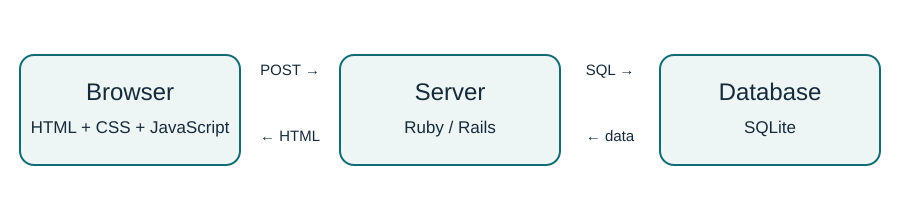

# Gang 4: Flaskepost med Ruby og Rails

**Mission:** Send et eventyr til en server, og få en rigtig HTML-side tilbage.

**Du lærer:** lidt Ruby, HTTP, GET, POST, routes, controller og view. Vi bruger Rails til at samle delene. Denne gang viser vi teksten; næste gang gemmer vi den.

**Start:** Underviseren giver jer to adresser og et holdpassword: én til browsereditoren og én til jeres app. Browsereditoren ligner VS Code. Der er allerede installeret Ruby, Rails og SQLite på serveren. I skal ikke installere dem på jeres Windows-maskine.

## Plan: 120 minutter

| Minutter | Aktivitet |
|---|---|
| 0-10 | Genbesøg den lokale logbog. Hvorfor kan andre ikke se den? |
| 10-25 | Åbn fjerneditoren, start appen, og find tre vigtige filer. |
| 25-40 | Ruby-laboratorium i terminalen. |
| 40-55 | Følg en formular fra browser gennem en route til en controller. |
| 55-65 | Pause. |
| 65-85 | Modtag og vis flaskeposten. |
| 85-100 | Afprøv tomme felter, lang tekst og HTML-tegn. |
| 100-115 | Egen ændring og bonusmission. |
| 115-120 | Forklar datarejsen for en makker. |

## 1. Start jeres app

Åbn browsereditoren. Hvis den viser **Restricted Mode**, så få underviseren til at bekræfte tillid til den udleverede kursusmappe. Vælg derefter **Terminal → New Terminal**. Skriv de tre linjer, én ad gangen:

```sh
cd /workspace/undervisning/04-flaskepost/start
bin/rails db:prepare
bin/rails server -b 0.0.0.0
```

Terminalen bliver optaget, mens serveren kører. Det er normalt. Åbn jeres **app-adresse** i en anden fane; log ind med holdnavn og holdpassword. Serveren modtager endnu ikke navn og tekst korrekt, fordi vi mangler to trin.

**Vigtigt:** Luk ikke terminalen under arbejdet. For at stoppe serveren klikker du i terminalen og trykker Ctrl + C. Kun én Rails-server må bruge port 3000 i jeres miljø ad gangen.

Åbn filerne i mappen `04-flaskepost/start`. Arbejdet ligger nu på serveren, ikke på din Windows-maskine. Gem stadig med Ctrl + S. Rails indlæser kodeændringer, når du opdaterer siden.

## 2. Fem minutter med Ruby

Åbn endnu en terminal. Skriv `irb` og prøv én linje ad gangen:

```ruby
pirat = "Kaptajn Krabbe"
guld = 12
guld + 8
"Hej, #{pirat}!"
guld >= 20
```

Ruby bruger ikke `var`, og variabler behøver normalt ikke semikolon. `#{pirat}` sætter en variabel ind i en tekst med dobbelte anførselstegn. Ruby og JavaScript er forskellige sprog, men begge kan huske værdier og tage beslutninger.

Prøv derefter:

```ruby
if guld >= 20
  puts "Du vandt!"
else
  puts "Find mere guld."
end
```

`puts` skriver tekst. `end` afslutter blokken. Skriv `exit` for at forlade Ruby-laboratoriet. Disse forsøg skal ikke kopieres ind i appens filer.

## 3. Følg flaskeposten



Åbn `config/routes.rb`:

```ruby
get "flaskepost", to: "flaskepost#new"
post "flaskepost", to: "flaskepost#create"
```

**GET** beder om en side. **POST** sender formularens data. En **route** er en vejviser: den forbinder en adresse og en HTTP-metode med en bestemt controller-metode.

Åbn `app/views/flaskepost/new.html.erb`. Find formularen:

```erb
<%= form_with url: flaskepost_path, method: :post, local: true do |form| %>
```

Rails laver et almindeligt HTML-`form` ud fra denne kode. `form.label`, `form.text_field` og `form.text_area` laver felter, som dem fra gang 2. Vi bruger ikke JavaScript til at stoppe submit denne gang. Browseren sender formularen til serveren.

**Undersøg:** Højreklik på formularen i app-fanen og vælg Vis sidens kilde. Kan du finde `<form>`, `name="pirat"` og et skjult sikkerhedsfelt? Browseren modtager HTML, ikke Ruby-koden.

## 4. Læs formularens data

Åbn `app/controllers/flaskepost_controller.rb`. Find de to linjer med `TRIN 1` inde i `create`. Erstat dem med:

```ruby
@pirat = params[:pirat].to_s.strip
@tekst = params[:tekst].to_s.strip
```

`params` indeholder data fra forespørgslen. `:pirat` er feltets navn. `to_s` gør værdien til tekst, og `strip` fjerner mellemrum i enderne. `@` gør variablen tilgængelig i det view, som controlleren viser.

Den udleverede kode kontrollerer længderne. Godkendte data vises med `render :vis`. Ellers vises formularen igen med en fejlbesked. Vi kontrollerer også på serveren, fordi browserens `required` kan omgås.

## 5. Vis svaret

Åbn `app/views/flaskepost/vis.html.erb`. Erstat kommentaren `TRIN 2` med:

```erb
<p><strong><%= @pirat %></strong>: <%= @tekst %></p>
```

**ERB** er HTML med små stykker Ruby. `<%= ... %>` beregner noget og skriver resultatet ind i HTML. `<% ... %>` kører kode uden selv at skrive et resultat, fx en betingelse.

**Kontrol:** Gem begge filer. Send en flaskepost. Den nye side skal vise jeres navn og eventyr. Ingen data er endnu lagt i en database.

## Makkerprøven

1. Send et normalt eventyr. Hvilken tekst kommer fra formularen?
2. Prøv kun mellemrum. Du skal få en forståelig fejl.
3. Skriv `<script>alert(1)</script>` som eventyr. Det skal vises som tekst. Rails escaper output; brug ikke `raw` eller `html_safe` på brugerens tekst.
4. Klik *Send en ny flaskepost*. Den nye GET-side er tom. Browseren kan spørge om genafsendelse, hvis du i stedet trykker F5 på et POST-svar; det er ikke en database.
5. Åbn appen på makkerens maskine. Der er ingen fælles historik endnu.

## Bonusmissioner

- **Let:** Ændr sidens overskrift og knaptekst. Find ud af, hvilke dele der ligger i layoutet, og hvilke der ligger i det enkelte view.
- **Mellem:** Tilføj skibsnavn i formularen. Læs det med `params[:skib].to_s.strip`, og vis `@skib` i svaret. Lav også en længdekontrol.
- **Svær:** Vis en særlig besked, hvis eventyret nævner `skat`. Hint: `@tekst.downcase.include?("skat")` og en `if` i viewet.

## Før du går

Tegn: browser → route → controller → view → browser. Fortæl, hvor Ruby kører, og hvorfor en lokal HTML-fil ikke kan køre Rails. Gem alle filer. Behold mappen; næste gang åbner vi en ny startmappe med samme flaskepost og en databaseøvelse.
